<p align="center">
  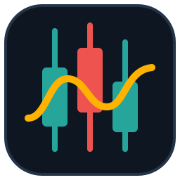
</p>

<h1 align="center">TickView</h1>

<p align="center">
  <b>A native TradingView-parity charting terminal in Rust + egui.</b><br>
  Candles, 83 indicators, 90 drawing tools, watchlist, alerts and bar replay —<br>
  with free, keyless market data. No Electron, no account, no API keys.
</p>

<p align="center">
  
  
  
  
  <a href="https://github.com/osenvosem/tickview/actions/workflows/ci.yml"></a>
</p>

<br>

<p align="center">
  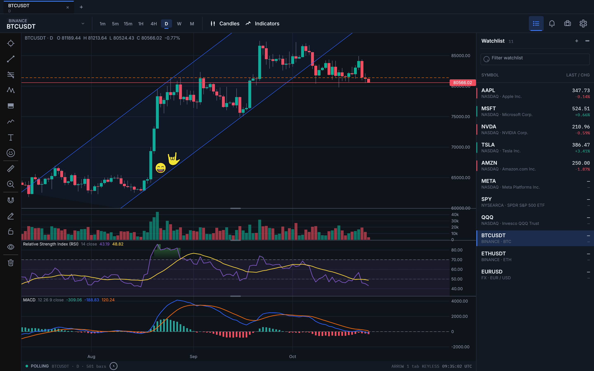
  <br>
  <sub>BTC/USDT daily — channel drawing, RSI + MACD panes, watchlist, favourited tool rail.</sub>
</p>

## Features

- **Charting**: 8 intervals (1m–1M), 8 series styles, log scale, multi-pane
  with grabbable splitters, crosshair with snap magnet, rectangle zoom.
- **Indicators**: 83, with TradingView-matching names and defaults, golden-value tested math,
  per-parameter editor, favourites, templates, HTF resampling and session VWAP.
- **Drawings**: 90 verified tools — trend lines, pitchforks, Gann/Fibonacci,
  chart patterns, Elliott waves, forecasting, shapes, notes, images, emoji,
  anchored VWAP, volume profiles, bars pattern, ghost feed, editable tables.
  Per-object style/lock/hide/z-order, all persisted per symbol.
- **Live data**: Binance websocket streaming (`LIVE` dot) plus REST tails;
  bar replay with transport controls steps through history at x1–x64.
- **Shell**: tabs, watchlist, symbol search, price alerts with sound, dark
  (Graphite) and light themes, full layout persistence (config v2).

## Gallery

<table>
  <tr>
    <td width="50%">
      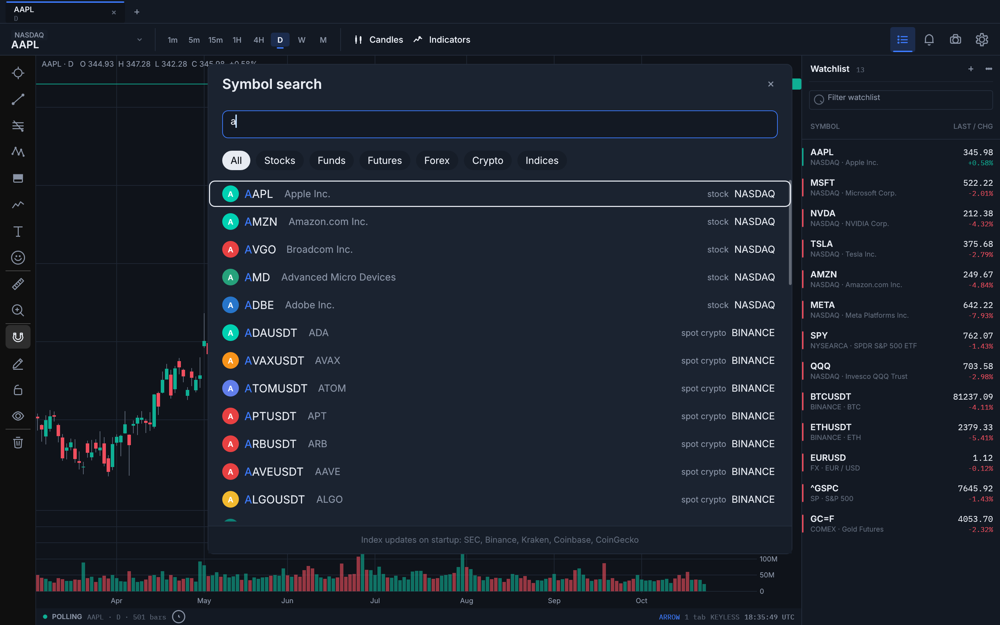
      <br><sub><b>Symbol search</b> — <code>⌘K</code>: category chips, exchange labels, curated offline index.</sub>
    </td>
    <td width="50%">
      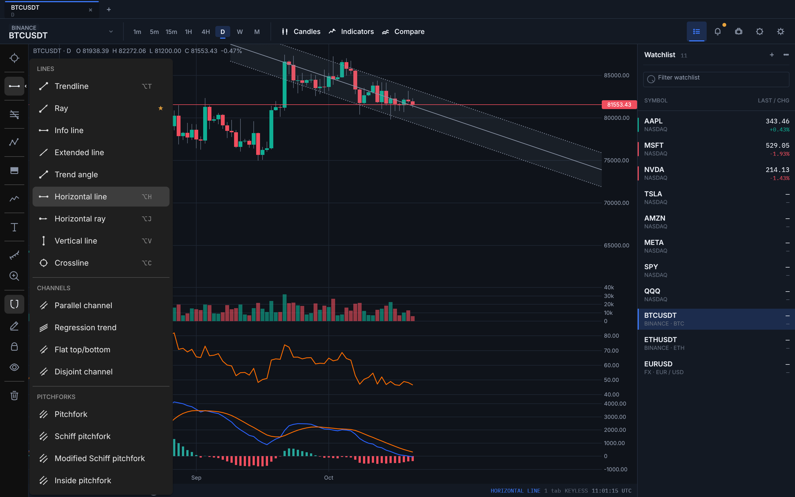
      <br><sub><b>Grouped tool rail</b> — one button per family, flyout selectors, global favourites.</sub>
    </td>
  </tr>
  <tr>
    <td width="50%">
      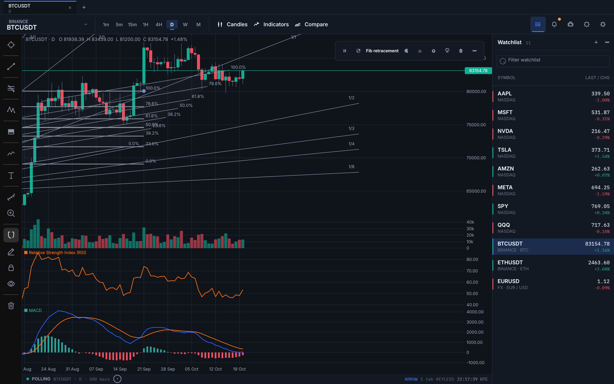
      <br><sub><b>Gann &amp; Fibonacci</b> — ratio-accurate fans and level sets, verified on linear and log axes.</sub>
    </td>
    <td width="50%">
      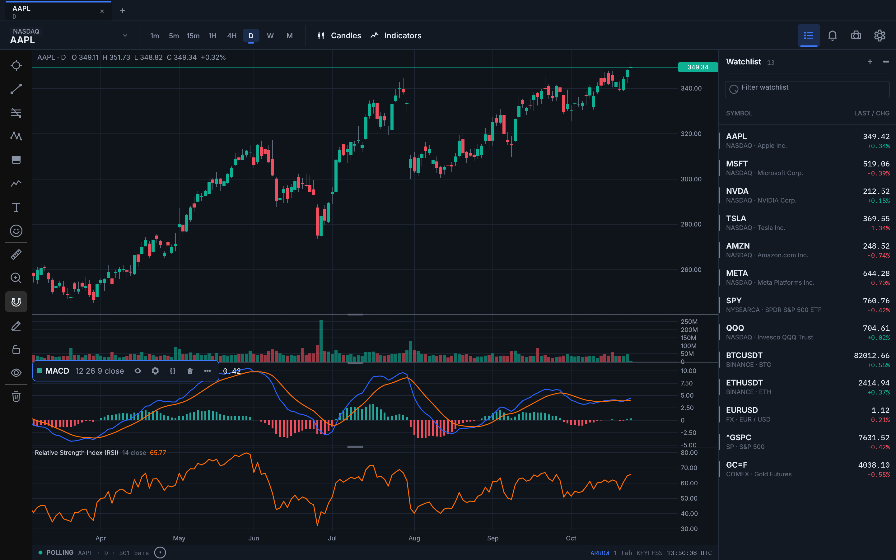
      <br><sub><b>Indicator legend actions</b> — hover a legend row: swatch, inputs, eye, gear, menu (alert, reorder, move, remove).</sub>
    </td>
  </tr>
  <tr>
    <td width="50%">
      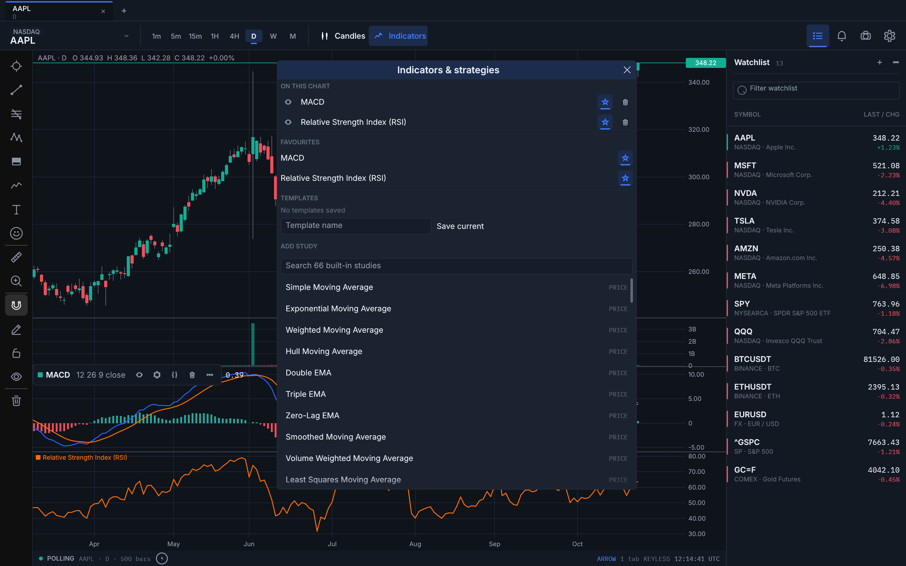
      <br><sub><b>Indicator browser</b> — favourites, templates, keyword search; <code>⌥A</code> adds all favourites.</sub>
    </td>
    <td width="50%">
      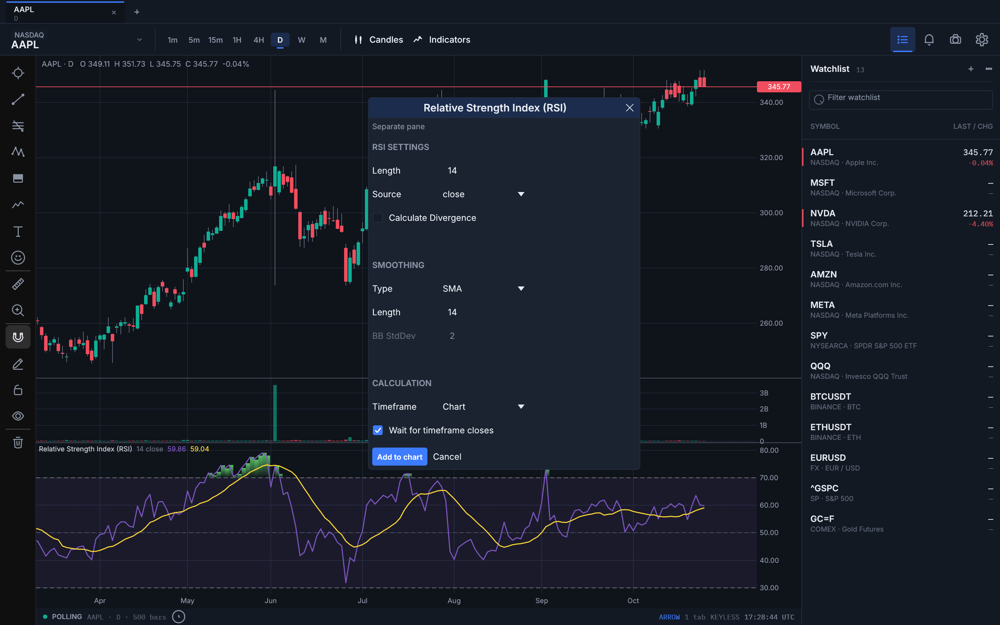
      <br><sub><b>Parameter editor</b> — every indicator input editable, live-applied and persisted.</sub>
    </td>
  </tr>
  <tr>
    <td width="50%">
      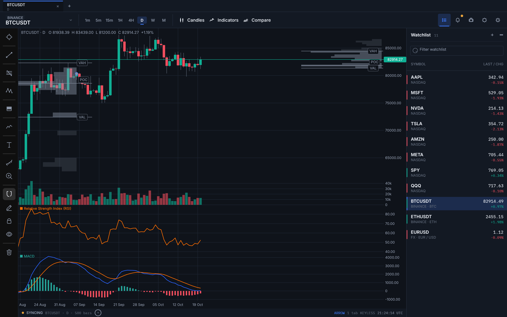
      <br><sub><b>Volume profiles</b> — fixed-range and anchored, POC + 70% value area computed live.</sub>
    </td>
    <td width="50%">
      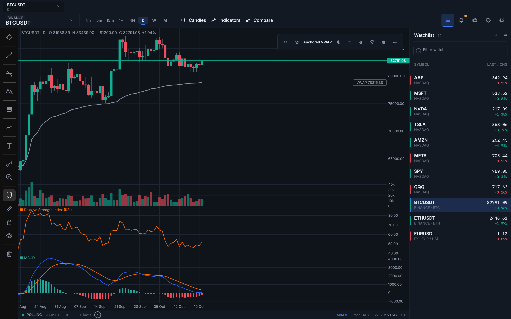
      <br><sub><b>Anchored VWAP</b> — ΣTP·V/ΣV from the anchor bar, recomputed from loaded history.</sub>
    </td>
  </tr>
  <tr>
    <td width="50%">
      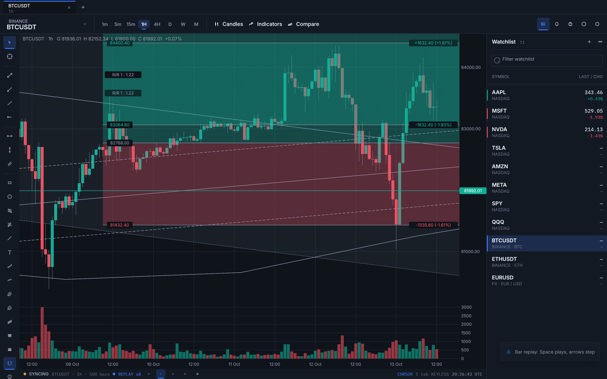
      <br><sub><b>Bar replay</b> — <code>Space</code> play/pause, <code>←</code>/<code>→</code> step, x1–x64.</sub>
    </td>
    <td width="50%">
      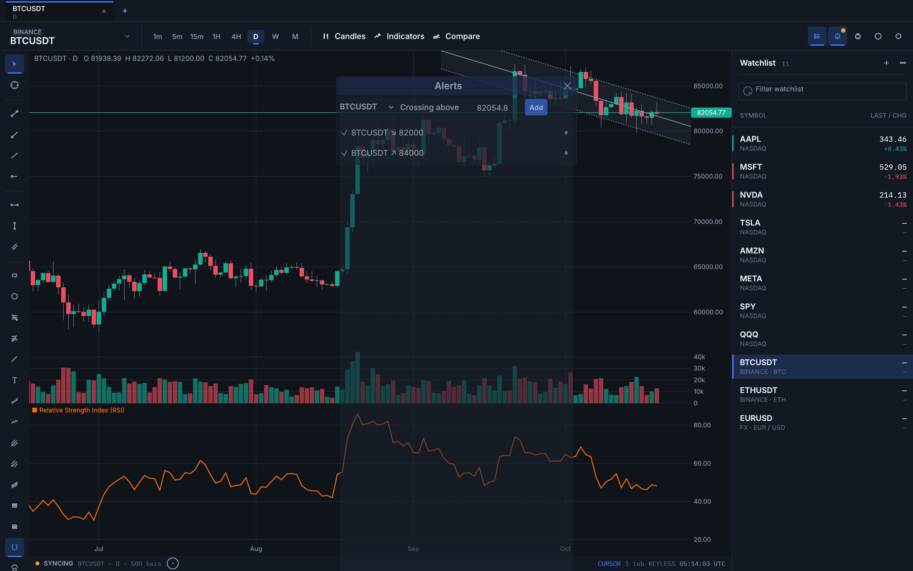
      <br><sub><b>Price alerts</b> — cross above/below, native notification + sound, persisted.</sub>
    </td>
  </tr>
  <tr>
    <td width="50%">
      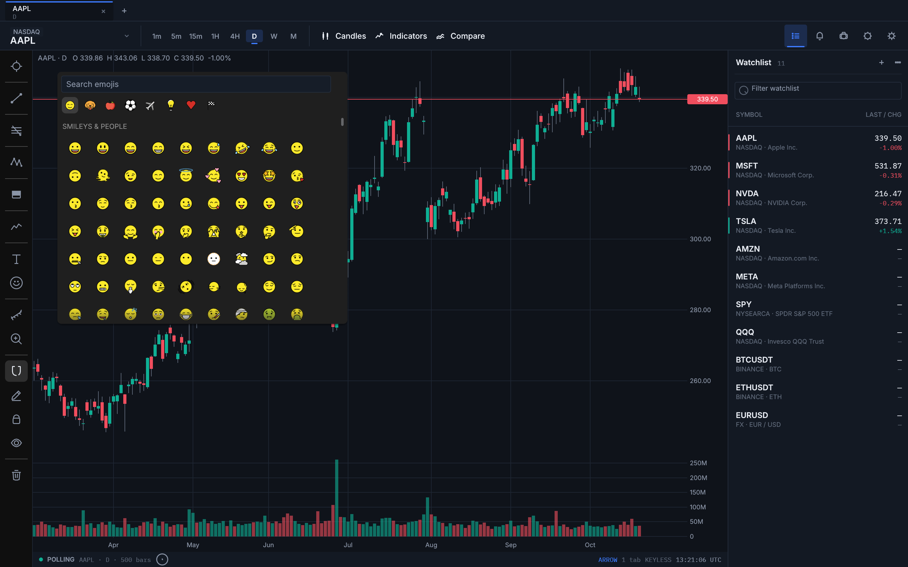
      <br><sub><b>Emoji annotations</b> — 1,584 OpenMoji glyphs, searchable, placed straight on the chart.</sub>
    </td>
    <td width="50%">
      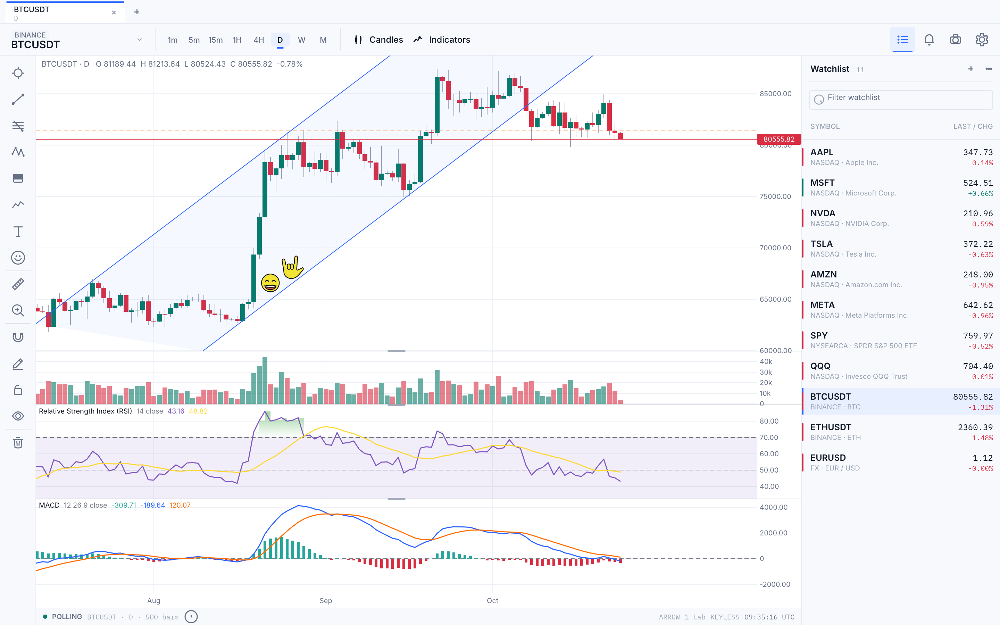
      <br><sub><b>Paper light theme</b> — token-driven, switchable at runtime (<code>⌘,</code>).</sub>
    </td>
  </tr>
</table>

## Keyboard shortcuts

| Key | Action |
| --- | --- |
| `⌘K` | symbol search |
| `⌘T` / `⌘W` | new tab / close tab |
| `⌘,` | settings |
| `⌥T` `⌥H` `⌥J` `⌥V` `⌥C` `⌥F` | trendline, horizontal line/ray, vertical line, crossline, fib retracement |
| `⇧⌥R` | rectangle |
| `⌥A` | add all favourite indicators |
| `⌥L` | lock/unlock drawings |
| `Esc` | close dialogs, unpin indicator legend rows |
| `Space`, `←` `→` | replay play/pause, step |

## Install

Grab a prebuilt installer from [GitHub Releases](https://github.com/osenvosem/tickview/releases):

| Platform | Formats |
| --- | --- |
| macOS 11+ (Apple Silicon / Intel) | `.dmg`, `.zip` |
| Windows 10/11 (x86_64 / ARM64) | `.zip` |
| Linux (amd64 / arm64) | `.deb`, `.rpm`, `.tar.gz` |

macOS builds are ad-hoc signed (no Developer ID), so first launch needs
right-click → Open. Releases are prerelease until 1.0.

### Build from source

```sh
cargo build --release -p tickview   # binary: target/release/tickview
cargo test --workspace             # 486 tests (6 ignored live smokes)
cargo clippy --workspace --all-targets
```

## Data & privacy

Every feed is free and keyless: Binance, Kraken, Coinbase, Nasdaq, Yahoo,
CoinGecko, Frankfurter and ExchangeRate-API. Quotes and bars are cached in
`~/.config/tickview/` (`config.json`, `candles.sqlite`); no credentials are
stored and no market data is redistributed. TickView is alpha software and
nothing it displays is investment advice.

TickView is an independent, clean-room reimplementation of charting-terminal
behaviour studied from TradingView's public UI. It is not affiliated with,
endorsed by, or sponsored by TradingView, Inc.; "TradingView" is a trademark
of TradingView, Inc.

## Architecture

| Crate | Role |
| --- | --- |
| `ta` | indicator engine: 83 indicators, golden-value tests, HTF/comparison context |
| `marketdata` | providers, router + circuit breaker, search, SQLite cache, Binance websocket, alerts |
| `tickchart` | chart engine: axes, series styles, drawing catalog, panes, legend, replay |
| `app` | shell: tabs, rail, watchlist, dialogs, persistence |

Parity with TradingView is tracked in [`PARITY.md`](PARITY.md) and the
generated [`docs/parity/STATUS.md`](docs/parity/STATUS.md); evidence lives in
[`docs/evidence/`](docs/evidence/).

## License

MIT or Apache-2.0, at your option — see
[`LICENSE-MIT`](LICENSE-MIT) / [`LICENSE-APACHE`](LICENSE-APACHE). Bundled
artwork and fonts (Inter, IBM Plex Mono, Noto Emoji, OpenMoji) are covered by
OFL-1.1 / CC BY-SA 4.0; full provenance in
[`THIRD_PARTY_NOTICES.md`](THIRD_PARTY_NOTICES.md).
